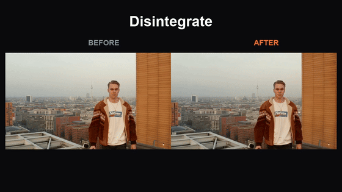

# One-take VFX

Upload a short phone clip, pick an effect, get the clip back with the effect added: **disintegrate, levitate, set on fire, portal, time-freeze** and three more. An open-weights take on the viral "Effects" apps, built on **LTX 2.5** in **ComfyUI**. Nothing leaves your machine: no partner nodes, no closed APIs, no closed LLM in the loop (presets are hand-written prompt templates).



*Left: the input clip. Right: the render. Eight presets, three clips: [`demo/outputs/`](demo/outputs). Stock input clips are from Mixkit ([license](https://mixkit.co/license/#videoFree)), see [`assets/clips/SOURCES.md`](assets/clips/SOURCES.md).*

## How it works

```
input clip ──► fit to 768x448 ──┬─► Canny edges (half size) ──► LTX IC-LoRA control guide ─┐
                                └─► first frame ──► latent anchor (keeps person + scene) ──┤
preset prompt ──► Gemma 4 text encoder ─────────────────────────────────────────────────────┤
                                                                                            ▼
                                          LTX 2.5 distilled (8 steps) ──► decode ──► MP4
```

- The clip's **motion** comes from a Canny edge video fed through the LTX IC-LoRA (in-context control). The person keeps moving the way they moved.
- The clip's **first frame** is locked into the latent, so the person, clothes and room stay recognisable.
- The **effect** comes from the preset prompt. Each preset also sets how tightly the control signal holds (`control_strength`): high for subtle effects, lower where the effect has to change the silhouette (fire, portal, debris).

The same graph runs inside ComfyUI (`workflows/`) and behind the small web app (`app/`).

## Models (exact files, sources, licenses)

| File | Folder | Size | Source |
|---|---|---|---|
| `ltx-2.5-22b-distilled-transformer-comfy-int8-convrot.safetensors` | `diffusion_models/` | 21.5 GB | [Lightricks/LTX-2.5](https://huggingface.co/Lightricks/LTX-2.5) (gated) |
| `gemma4-12b-with-proj-ltx-2.5-comfy-int8-convrot.safetensors` | `text_encoders/` | 15.4 GB | [Lightricks/LTX-2.5](https://huggingface.co/Lightricks/LTX-2.5) (gated) |
| `ltx-2.5-video-vae-bf16.safetensors` | `vae/` | 1.5 GB | [Lightricks/LTX-2.5](https://huggingface.co/Lightricks/LTX-2.5) (gated) |
| `ltx-2.5-audio-vae-bf16.safetensors` | `vae/` | 0.4 GB | [Lightricks/LTX-2.5](https://huggingface.co/Lightricks/LTX-2.5) (gated) |
| `ltx-2.3-22b-ic-lora-union-control-ref0.5.safetensors` | `loras/` | 0.65 GB | [Lightricks/LTX-2.3-22b-IC-LoRA-Union-Control](https://huggingface.co/Lightricks/LTX-2.3-22b-IC-LoRA-Union-Control) |

The first four are the files ComfyUI's own LTX 2.5 template uses (`video_ltx2_5_i2v`). The IC-LoRA was trained on LTX-2.3; the LTX-2.5 model card says "the large majority of LoRAs and IC-LoRAs trained on LTX-2.3 run on LTX-2.5 without changes", and the renders in this repo are the validation for this one.

**Licenses.** LTX models and the IC-LoRA are under the [LTX-2.x Community License](https://github.com/Lightricks/LTX-2/blob/main/LICENSE-2_x): free for entities under $10M annual revenue (a paid agreement above that), with an acceptable-use policy that includes labeling machine-generated content when you share it. The model weights are **not** redistributed here and keep their own licenses. This repo's code is MIT.

Only open weights are used. Nothing in the workflow calls a partner node (`LtxApi*` nodes in ComfyUI are API nodes and are not used).

## Hardware

Tested on one **RTX 3090 (24 GB)** with ComfyUI's dynamic offloading (`--lowvram`) and 121 GB system RAM:

- 768x448, 97 frames (4 s at 24 fps): **about 70 s per clip** end to end, after the first load.
- Peak GPU memory observed: **23.9 GB** on the card, which includes about 5.8 GB held by other processes on the same machine. ComfyUI itself used about 18 GB.
- ComfyUI process RSS about 12 GB while rendering.

An RTX 5090 (32 GB) has more headroom than this test machine. That is an expectation, not something we measured.

## Setup

You need `git`, [`uv`](https://docs.astral.sh/uv/) and `ffmpeg`, an NVIDIA GPU, and a Hugging Face account that has accepted the [LTX-2.5 license](https://huggingface.co/Lightricks/LTX-2.5).

```bash
git clone <this repo> one-take-vfx && cd one-take-vfx

# 1. ComfyUI (pinned commits) + the one custom node pack the workflow needs, + this repo's preset node
scripts/install_comfyui.sh ~/onetake-comfyui

# 2. Models (about 39 GB). HF_TOKEN is a read token from the account that accepted the license
HF_TOKEN=hf_xxx scripts/download_models.sh ~/onetake-comfyui/ComfyUI/models

# 3. Start ComfyUI
~/onetake-comfyui/venv/bin/python ~/onetake-comfyui/ComfyUI/main.py --listen 127.0.0.1 --port 8188 --lowvram

# 4. Start the app (second terminal)
COMFYUI_URL=http://127.0.0.1:8188 uv run app/server.py
```

Open <http://127.0.0.1:7860>, drop in a clip, choose a preset, press **Render effect**. Progress streams live, the result plays in the page and downloads as MP4.

No clips handy? `scripts/fetch_sample_clips.sh` downloads three free ones.

**Any ComfyUI server works.** Point `COMFYUI_URL` at it (a local install, a rented GPU box, a cloud ComfyUI). It needs the files in the table above, the `ComfyUI-VideoHelperSuite` custom node, and this repo's `custom_nodes/onetake_vfx` (symlink it into `ComfyUI/custom_nodes/`). If it sits behind basic auth, also set `COMFYUI_USER` and `COMFYUI_PASSWORD`. For a remote box that listens only on localhost, tunnel it: `ssh -L 8188:127.0.0.1:8188 your-gpu-box`.

The app listens on `127.0.0.1` by default, only answers to `localhost`/`127.0.0.1` host names (override with `ALLOWED_HOSTS=name1,name2`, which blocks DNS rebinding) and rejects cross-origin POSTs. To share it, either set `APP_PASSWORD` (HTTP basic auth, any username), or open it with `ALLOWED_HOSTS=<your hostname>` plus abuse limits: `MAX_QUEUE=1` (reject jobs while the GPU is busy), `MAX_UPLOAD_MB=60`, `MAX_DURATION_S=8` (needs `ffprobe`) and `RATE_PER_HOUR=6` (per client IP; behind Cloudflare the `CF-Connecting-IP` header is used). Uploads are accepted only as MP4, MOV or WebM (checked by content), and effects only from `presets/`. Put it behind HTTPS before exposing it to the internet.

Batch rendering from the command line:

```bash
uv run scripts/render.py assets/clips/407_clip.mp4 set-on-fire out.mp4
scripts/render_all.sh        # every preset on every clip in assets/clips -> demo/outputs/
```

## Presets

Presets are plain JSON files in [`presets/`](presets). Included: `disintegrate`, `levitate`, `set-on-fire`, `portal`, `time-freeze`, `slow-mo-debris`, `rain-stop`, `hologram`, and four abstract looks: `neon-wireframe`, `aurora-trails`, `particle-bloom`, `liquid-chrome`.

```json
{
  "id": "set-on-fire",
  "name": "Set on Fire",
  "prompt": "Intense roaring flames engulf the person's whole body ...",
  "negative_prompt": "blurry, low quality, ...",
  "control_strength": 0.6,
  "anchor_strength": 1.0,
  "guide_motion": {"dy": 0, "dx": 0, "fade_below": 0, "region": [0, 1]},
  "num_frames": 97,
  "fps": 24,
  "lora": null
}
```

| Field | Meaning |
|---|---|
| `prompt` / `negative_prompt` | Describe the effect and say the person and camera stay as in the footage. |
| `control_strength` | 0 to 1. How firmly the input motion constrains the render. Lower lets the effect reshape the body; higher keeps it closer to the original. |
| `anchor_strength` | 0 to 1, default 1. How strongly the clip's first frame is locked into the render. 1 keeps the scene as filmed; near 0 lets the effect restyle the whole scene (the abstract presets use 0 to 0.35). |
| `guide_motion` | Optional. Moves the control guide over the clip so the render is pulled along: `dy`/`dx` are fractions of frame height/width reached at the last frame (negative `dy` is up, eased in), `region` limits the move to a horizontal band so background edges stay put, `fade_below` blacks out the bottom fraction of the guide. Used by `levitate`. |
| `num_frames` | Must be a multiple of 8, plus 1 (97 = 4 s at 24 fps). |
| `fps` | Output frame rate. |
| `lora` | Reserved for an optional extra open LoRA (name and link in the preset). None of the shipped presets uses one. |

**Add a preset:** copy a file in `presets/`, change `id`, `name` and `prompt`, restart the app. It appears as a button. In ComfyUI, restart so the `OneTakeVFX Preset` node picks it up.

## Workflows

In [`workflows/`](workflows), each in ComfyUI **API** format (`*_api.json`) and **UI** format (`*_ui.json`, drag into ComfyUI):

| Workflow | Use |
|---|---|
| `one_take_vfx_*` | The parameterised graph the app patches (prompt, size, frames, seed, strength). |
| `one_take_vfx_preset_node_*` | Same graph, driven by the **OneTakeVFX Preset** node: choose an effect from a dropdown inside ComfyUI, no app needed. |

`custom_nodes/onetake_vfx` is a small custom node pack with two nodes: **OneTakeVFX Preset** loads a preset from `presets/` and outputs its prompt, negative prompt, control and anchor strengths, frame count, fps and guide motion; **OneTakeVFX Guide Motion** moves the control guide over time. `scripts/install_comfyui.sh` symlinks it into ComfyUI. `scripts/build_workflow.py` regenerates the API workflows, and `scripts/api_to_ui.py` converts them to UI format through the real ComfyUI frontend.

## Known limits

- Effects that must change the whole silhouette (fire, portal, debris) trade off against how closely the original motion is followed. Tune `control_strength` per preset.
- `levitate` works on a person standing roughly in place (the control guide is moved upward over the clip). On a walking subject it does not lift, and on a wide shot with a small subject it can invent a new person.
- Results vary by clip and seed. On a wide shot with a small subject (the fisherman clip) levitate and time-freeze can be weak or swap the person; the close, well-lit clips work best.
- Faces can drift on long, strong effects. The first frame is locked; later frames are generated.
- Clips are fitted to 768 px on the long side (portrait and landscape both work) and capped at 97 frames. One person in frame works best.
- Output audio is not carried over from the input clip.
- The Canny control comes from a LoRA trained on LTX-2.3. It works on 2.5 in our renders, but it is not an official 2.5 file.

## Layout

```
app/            FastAPI server + single-page UI (talks to ComfyUI over HTTP/WebSocket)
presets/        effect presets (JSON)
workflows/      ComfyUI workflows, API + UI format
custom_nodes/   OneTakeVFX Preset node
scripts/        install, model download, render, workflow generation
demo/outputs/   rendered results (every preset on three clips)
```

## License

Code: [MIT](LICENSE). Models are under their own licenses, see above.
